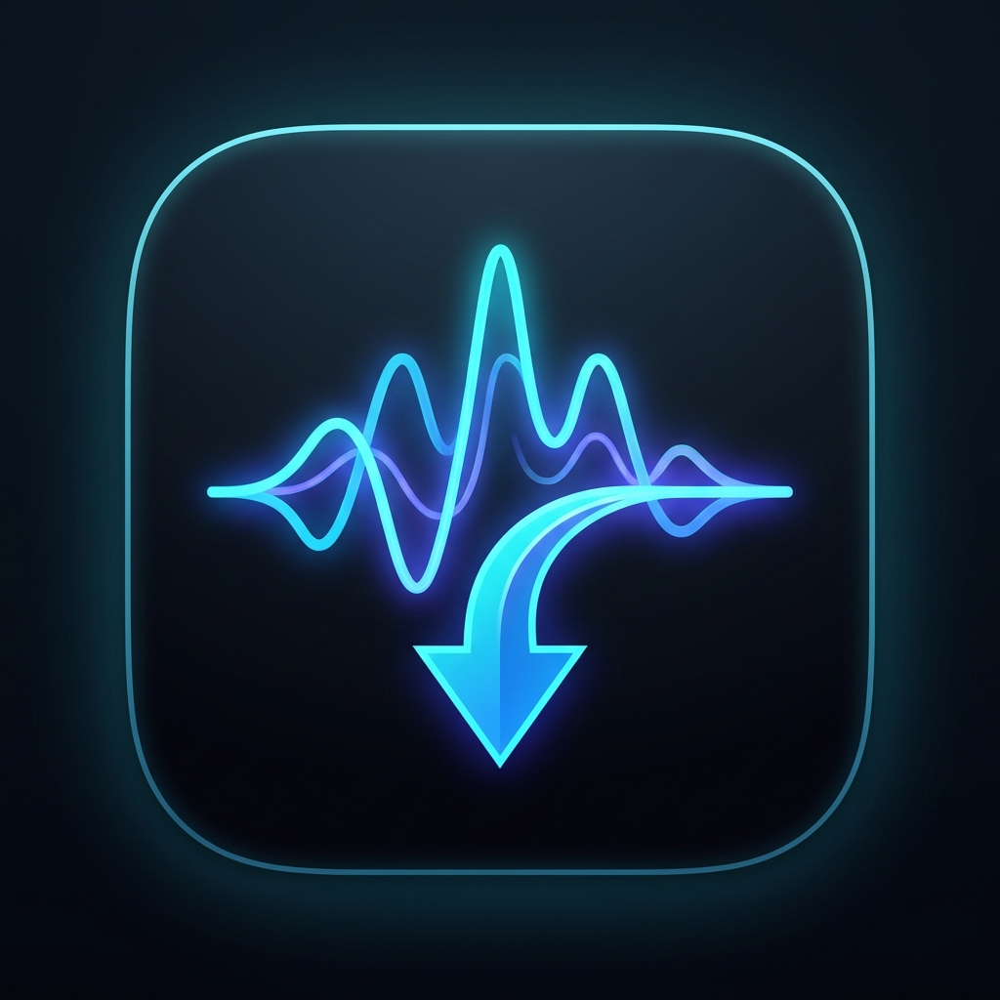

<p align="center">
  <br>
  <h1 align="center">TrackPull</h1>
  <p align="center"><b>Modern, High-Speed Music & Playlist Downloader for Windows</b></p>
</p>

<p align="center">
  
  
  
  
  
  
</p>

<p align="center">
  <a href="https://github.com/Dolane/TrackPull/releases/latest">
    
  </a>
</p>

> ### ⚡ Instant Download / Швидке завантаження
> **For standard users (No Python or technical setup required):**  
> Simply download the pre-compiled standalone executable:  
> 👉 **[Download TrackPull.exe (Latest Release)](https://github.com/Dolane/TrackPull/releases/latest)**  
> 
> **Для звичайних користувачів (без потреби встановлювати Python та консолі):**  
> Просто завантажте вже готовий автономний файл програми:  
> 👉 **[Завантажити TrackPull.exe (Останній стабільний реліз)](https://github.com/Dolane/TrackPull/releases/latest)**

---

> **TrackPull** is a sleek, multi-threaded Windows desktop application designed to download high-fidelity audio tracks and full playlists from hundreds of media platforms (including YouTube, SoundCloud, YouTube Music, and Bandcamp). Built with modern UI aesthetics, custom neon iconography, instant fullscreen responsiveness, parallel fragment streaming, automated metadata tagging, cover art embedding, and native FFmpeg integration.

---

## 📑 Language Navigation / Мова документації
- [English Documentation](#-english-documentation)
  - [Instant Download (.exe)](#-instant-download-exe)
  - [Key Features](#-key-features)
  - [Technology Stack](#-technology-stack)
  - [Prerequisites](#-prerequisites)
  - [Installation Guide](#-installation-guide)
  - [FFmpeg & Deno Setup on Windows](#-ffmpeg--deno-setup-on-windows)
  - [Running the Application](#-running-the-application)
  - [Building Standalone Windows Executable (.exe)](#-building-standalone-windows-executable-exe)
  - [Automated GitHub Releases (CI/CD)](#-automated-github-releases-cicd)
  - [Architecture & Design](#-architecture--design)
- [Українська документація](#-українська-документація)
  - [Швидке завантаження (.exe)](#-швидке-завантаження-exe)
  - [Основні можливості](#-основні-можливості)
  - [Технологічний стек](#-технологічний-стек)
  - [Системні вимоги](#-системні-вимоги)
  - [Покрокове встановлення](#-покрокове-встановлення)
  - [Встановлення FFmpeg та Deno на Windows](#-встановлення-ffmpeg-та-deno-на-windows)
  - [Запуск програми](#-запуск-програми)
  - [Компіляція у самостійний .exe файл](#-компіляція-у-самостійний-exe-файл)
  - [Автоматичні релізи на GitHub (CI/CD)](#-автоматичні-релізи-на-github-cicd)
  - [Архітектура проєкту](#-архітектура-проєкту)

---

# 🇬🇧 English Documentation

## 📥 Instant Download (.exe)
If you just want to use the application without installing Python, Git, or dependencies:
1. Navigate to the **[Latest Release](https://github.com/Dolane/TrackPull/releases/latest)** page.
2. In the **Assets** section, download `TrackPull.exe`.
3. Double-click `TrackPull.exe` to run. It is fully portable with zero installer clutter!

> [!NOTE]
> **Why isn't the `.exe` file committed directly to the git repository?**  
> In modern software engineering and Open Source standards, large binary files (27+ MB) are never stored in git commit trees to avoid permanently bloating repository clone size. Instead, binaries are officially hosted in **GitHub Releases** and automatically generated via GitHub Actions CI/CD workflows.

---

## ✨ Key Features

- **Distinctive Minimalist Iconography**: Custom-designed neon audio waveform merging with a download arrow, packaged as a multi-resolution `.ico` and embedded in the titlebar, header, and taskbar.
- **Adaptive Centered Grid Architecture**: Instant 60 FPS transitions between windowed and fullscreen with zero canvas lag. Controls maintain clean, symmetrical proportions in 1080p, 1440p, and 4K displays.
- **Parallel Stream Acceleration**: Downloads audio fragments in 8 concurrent streams (`concurrent_fragment_downloads: 8`) with a 10 MB chunk buffer for maximum broadband throughput.
- **Integrated Deno Runtime Support**: Eliminates YouTube extraction throttling and warnings by automatically detecting and utilizing Deno to solve JavaScript signature challenges in 1–2 seconds.
- **Multi-Format Extraction**: Export tracks into **MP3**, **M4A**, **FLAC** (Lossless), or **WAV** (Lossless).
- **Custom Bitrate Selection**: Configurable audio fidelity for lossy formats (**320 kbps**, **256 kbps**, **192 kbps**, **128 kbps**), automatically locking into lossless mode for FLAC/WAV.
- **Full Playlist Batch Processing**: Effortlessly download entire playlists with organized folder hierarchy and track numbering (`01 - Title.mp3`).
- **Automated Metadata & Cover Art**: Automatically embeds artist, title, album info, and high-resolution thumbnail images directly into ID3 / Vorbis tags.
- **Zero UI Freezing (Asynchronous Multithreading)**: All downloads and conversion tasks run in dedicated worker threads via Python's `threading` module with thread-safe UI updates dispatched via `.after()`.
- **Live Progress & Metrics**: Smooth animated progress bar, real-time transfer speed (`MB/s` or `KB/s`), estimated remaining time (`ETA`), percentage calculation, and operational phase labels.
- **Integrated Diagnostic Console**: Expandable multi-line activity log providing transparent feedback, deduplicated post-processing steps, and error diagnostics.
- **Error-Resilient Playlist Resumption**: If an individual song fails (e.g. unavailable/private), TrackPull automatically skips it or provides a prominent **"CONTINUE DOWNLOAD"** button to resume remaining tracks without re-downloading previously completed tracks. The download archive is stored isolated in `%LOCALAPPDATA%\TrackPull\archives\` so your music folder stays 100% clean with zero dot-files.
- **Dynamic Bilingual Support**: Instant on-the-fly switching between Ukrainian and English with human-friendly, non-technical labels.
- **Universal Keyboard Shortcuts**: Full support for `Ctrl+V` (Paste), `Ctrl+C` (Copy), `Ctrl+A` (Select All), `Ctrl+X` (Cut), and `Ctrl+Z` (Undo) across all keyboard layouts (Ukrainian, English, etc.) without requiring layout switching.
- **Smart Cleanup on Cancellation**: Stopping or cancelling an active download immediately purges all incomplete streams (`.part`, `.ytdl`, `.temp`) and orphaned thumbnails, keeping your library completely pristine.

---

## 🛠 Technology Stack

| Component | Technology | Description |
|---|---|---|
| **Language** | Python 3.11+ | Modern type annotations, dataclasses, and threading |
| **Interface** | CustomTkinter 5.2.2+ | Modern, high-DPI-aware Windows graphical interface |
| **Engine** | yt-dlp 2024.10.22+ | Robust media extraction API supporting 1,000+ platforms |
| **JS Engine** | Deno 2.9+ | High-speed JavaScript runtime for YouTube signature challenge execution |
| **Media Engine**| FFmpeg & FFprobe | Demuxing, audio conversion, metadata tagging, and cover art embedding |
| **Tagging** | Mutagen 1.47.0+ | Advanced ID3v2, FLAC, and MP4 tag injection |
| **Imaging** | Pillow (PIL) 10.4.0+ | Thumbnail conversion, multi-resolution `.ico` generation, and UI branding |
| **Packaging** | PyInstaller 6.10.0+ | Generates portable single-file Windows `.exe` binaries with custom icon |

---

## 📋 Prerequisites

1. **Operating System**: Windows 10 or Windows 11 (64-bit recommended).
2. **Python**: Python 3.11 or newer installed with "Add Python to PATH" enabled.
3. **FFmpeg**: Required for audio transcoding (MP3/FLAC) and cover art embedding.
4. **Deno** *(Recommended)*: High-speed JavaScript runtime enabling instant playlist extraction without YouTube throttling.

---

## 🚀 Installation Guide

### Step 1: Clone the Repository
Open PowerShell or Command Prompt and clone the repository:
```powershell
git clone https://github.com/Dolane/TrackPull.git
cd TrackPull
```

### Step 2: Create a Virtual Environment
Isolate dependencies by creating a dedicated virtual environment:
```powershell
python -m venv venv
```

Activate the virtual environment:
- **PowerShell**:
  ```powershell
  .\venv\Scripts\Activate.ps1
  ```
  *(If execution policies block script activation, run: `Set-ExecutionPolicy -Scope Process -ExecutionPolicy RemoteSigned`)*
- **Command Prompt (CMD)**:
  ```cmd
  venv\Scripts\activate.bat
  ```

### Step 3: Install Required Dependencies
```powershell
pip install --upgrade pip
pip install -r requirements.txt
```

---

## 🔧 FFmpeg & Deno Setup on Windows

### Method 1: Windows Package Manager (`winget`) — Recommended
Run the following commands in PowerShell:
```powershell
# Install FFmpeg for audio conversion & metadata tagging
winget install Gyan.FFmpeg

# Install Deno for accelerated YouTube signature challenge solving
winget install DenoLand.Deno
```
*Restart TrackPull after the installation completes.*

### Method 2: Portable Mode (No System Changes)
1. Download [FFmpeg Builds](https://www.gyan.dev/ffmpeg/builds/) and extract `ffmpeg.exe` and `ffprobe.exe` into the `TrackPull/bin/` subfolder.
2. Download [Deno Releases](https://github.com/denoland/deno/releases) and place `deno.exe` into the `TrackPull/bin/` subfolder.
3. TrackPull automatically detects and injects binaries inside `./bin` into runtime PATH!

---

## 💻 Running the Application

Ensure your virtual environment is active, then launch:
```powershell
python main.py
```

---

## 📦 Building Standalone Windows Executable (.exe)

You can package **TrackPull** into a single, self-contained `.exe` bundled with the custom icon and assets that runs without Python installed.

### PyInstaller Build Command:
```powershell
pyinstaller --noconsole --onefile --icon="assets/icon.ico" --add-data="assets;assets" --name "TrackPull" --collect-all "customtkinter" --collect-all "yt_dlp" main.py
```

### Flag Breakdown:
- `--onefile`: Bundles the application into a single executable located in `dist/TrackPull.exe`.
- `--noconsole`: Suppresses the background terminal window for a clean desktop experience.
- `--icon="assets/icon.ico"`: Embeds the custom neon geometric icon into the `.exe` binary.
- `--add-data="assets;assets"`: Bundles branding images for window header and taskbar rendering.
- `--name "TrackPull"`: Assigns the executable filename.
- `--collect-all "customtkinter"`: **Crucial!** Bundles all JSON theme configurations and font files required by CustomTkinter.
- `--collect-all "yt_dlp"`: Collects dynamic platform extractors and dependencies.

After compilation completes, find your executable at:
```
dist\TrackPull.exe
```

---

## 🤖 Automated GitHub Releases (CI/CD)

TrackPull includes a pre-configured automated GitHub Actions workflow in [`.github/workflows/release.yml`](.github/workflows/release.yml).

### How It Works:
1. Whenever you push a git version tag (e.g. `v1.0.1`):
   ```powershell
   git tag v1.0.1
   git push origin v1.0.1
   ```
2. GitHub Actions automatically spins up a clean Windows virtual machine, sets up Python 3.12, installs dependencies, compiles `TrackPull.exe` via PyInstaller, and attaches the binary directly to the GitHub Release!
3. Alternatively, you can publish a release manually on GitHub by clicking **Releases -> Draft a new release** and dragging `TrackPull.exe` into the binary upload box.

---

## 🏗 Architecture & Design

TrackPull adheres to clean, object-oriented design patterns:

```text
TrackPull/
├── assets/                  # Brand imagery & icon assets
│   ├── icon.ico             # Multi-resolution Windows icon (16x16 to 256x256)
│   └── icon.png             # High-resolution PNG for in-app header branding
├── bin/                     # Local binaries (FFmpeg, Deno - optional portable mode)
├── main.py                  # Primary application entrypoint, GUI classes & worker thread
├── requirements.txt         # Pinned production dependencies
├── .gitignore               # Python & PyInstaller exclusions
├── LICENSE                  # MIT License
└── README.md                # Comprehensive documentation
```

### Architectural Highlights:
1. **Separation of Concerns**:
   - `SystemDependencyChecker`: Verifies FFmpeg and Deno presence across PATH, WinGet paths, local `./bin`, and PyInstaller `_MEIPASS` frozen contexts. Automatically prepends valid directories to runtime `PATH`.
   - `DownloadOptions`: Immutable dataclass holding user-configured state.
   - `AudioDownloadWorker`: Runs asynchronous `yt_dlp.YoutubeDL` tasks inside a non-daemon `threading.Thread` with 8 parallel fragment streams.
   - `YTDLPMessageLogger`: Formats and selectively routes engine messages without flooding the event loop.
   - `TrackPullApp`: Inherits from `customtkinter.CTk`, implementing an adaptive 3-column centered grid layout, theme switching, input validation, and thread dispatching via `self.after(0, ...)`.
2. **Thread Safety**: Worker threads communicate with the interface strictly through `self.after(0, callback)` to guarantee zero race conditions with Tkinter's internal Tcl/Tk interpreter.

---
---

# 🇺🇦 Українська документація

## 📥 Швидке завантаження (.exe)
Якщо вам потрібна готова програма і ви не плануєте розробляти або змінювати код:
1. Перейдіть на сторінку **[Останній стабільний реліз](https://github.com/Dolane/TrackPull/releases/latest)**.
2. У розділі **Assets** завантажте файл `TrackPull.exe`.
3. Запустіть `TrackPull.exe` подвійним кліком миші. Програма повністю портативна та не потребує встановлення!

> [!NOTE]
> **Чому `.exe` файл не зберігається прямо в репозиторії вихідного коду?**  
> За професійними стандартами розробки на GitHub великі бінарні файли (27+ МБ) ніколи не пушать прямо в комміти, щоб не перевантажувати репозиторій і не уповільнювати завантаження коду (`git clone`). Офіційним і безпечним місцем для розміщення готових програм є розділ **GitHub Releases**, де збірка виконується автоматично через GitHub Actions.

---

## ✨ Основні можливості

- **Унікальна мінімалістична айдентика**: Фірмова неонова іконка (поєднання звукової хвилі та стрілки завантаження), інтегрована у форматі `.ico` у виконуваний файл, заголовок вікна та панель завдань.
- **Адаптивна 3-колонкова архітектура інтерфейсу**: Миттєве (60 FPS) масштабування між віконним та повноекранним режимами без затримок перемальовування канвасу. У повноекранному режимі картки налаштувань зберігають естетичні пропорції по центру, а журнал подій гармонійно заповнює нижню частину.
- **Прискорене багатопотокове завантаження**: Завантаження DASH/HLS фрагментів у 8 паралельних потоків (`concurrent_fragment_downloads: 8`) із буфером 10 МБ для максимального використання швидкості інтернет-каналу.
- **Підтримка рушія JavaScript (Deno)**: Повністю усуває тротлінг (штучне обмеження швидкості) та затримки з боку YouTube — парсинг плейлистів триває лише 1–2 секунди.
- **Підтримка популярних аудіоформатів**: Експорт треків у **MP3**, **M4A**, **FLAC** (Без втрат / Lossless) або **WAV** (Без втрат / Lossless).
- **Вибір якості та бітрейту**: Налаштування якості для стиснених форматів (**320 kbps**, **256 kbps**, **192 kbps**, **128 kbps**) з автоматичним блокуванням для нестиснених форматів FLAC/WAV.
- **Завантаження цілих плейлистів**: Зручне збереження альбомів та списків відтворення в окремі підпапки з нумерацією треків (`01 - Назва.mp3`).
- **Автоматичні метадані та обкладинки**: Запис ID3-тегів (виконавець, назва пісні, альбом) та вбудовування оригінальних обкладинок високої роздільної здатності.
- **Багатопоточність без зависань (Multi-threading)**: Усі ресурсомісткі операції завантаження й перекодування виконуються у фоновому потоці (`threading.Thread`), забезпечуючи 100% плавний та чуйний інтерфейс.
- **Плавний Progress Bar та живі метрики**: Відображення відсотка завантаження, поточної швидкості передачі даних (`MB/s` або `KB/s`), залишкового часу (`ETA`) та поточної стадії постобробки.
- **Наочний лічильник треків у плейлисті**: Чітке відображення поточної та загальної кількості пісень (наприклад, `Плейлист: 2 з 30 (2/30)`) як у виділеному бейджику інтерфейсу, так і в журналі дій.
- **Відновлення завантаження після помилки (Продовжити)**: Якщо окремий файл не вдалося завантажити (видалене або приватне відео), з'являється зелена кнопка **«ПРОДОВЖИТИ ЗАВАНТАЖЕННЯ»**, яка пропускає збійний трек і продовжує завантаження решти пісень без повторного завантаження вже готових. Архів завантажень ізольовано зберігається в `%LOCALAPPDATA%\TrackPull\archives\`, залишаючи папку з музикою на 100% чистою без зайвих файлів.
- **Повна двомовність (UA / EN)**: Миттєве перемикання між українською та англійською мовами без перезапуску та зрозумілі назви функцій без складної термінології.
- **Універсальні гарячі клавіші**: Повна підтримка `Ctrl+V` (Вставка), `Ctrl+C` (Копіювання), `Ctrl+A` (Виділити все), `Ctrl+X` (Вирізати) та `Ctrl+Z` (Скасувати) на будь-якій розкладці клавіатури (українській, англійській тощо) без потреби перемикання мови.
- **Розумне очищення при зупинці**: При натисканні кнопки «Зупинити» програма автоматично видаляє всі незавершені потоки (`.part`, `.ytdl`, `.temp`) та тимчасові незашиті обкладинки, залишаючи лише успішно завантажені треки.

---

## 🛠 Технологічний стек

| Компонент | Технологія | Призначення |
|---|---|---|
| **Мова** | Python 3.11+ | Типізація, датакласи, багатопотоковість |
| **Інтерфейс** | CustomTkinter 5.2.2+ | Сучасний GUI з підтримкою тем та високої чіткості DPI |
| **Движок** | yt-dlp 2024.10.22+ | Потужний рушій завантаження аудіо з понад 1000 сайтів |
| **JS-рушій** | Deno 2.9+ | Виконання JavaScript-челенджів для швидкого аналізу YouTube |
| **Мультимедіа**| FFmpeg & FFprobe | Конвертація потоків, зшивання аудіо, запис тегів і обкладинок |
| **Теги** | Mutagen 1.47.0+ | Робота з ID3v2, FLAC та MP4 метаданими |
| **Зображення** | Pillow 10.4.0+ | Генерація багатошарових `.ico` іконок та обробка обкладинок |
| **Збірка** | PyInstaller 6.10.0+ | Компіляція у портативний `.exe` для Windows із власною іконкою |

---

## 📋 Системні вимоги

1. **Операційна система**: Windows 10 або Windows 11 (64-біт).
2. **Python**: Версія 3.11 або новіша (із позначкою "Add Python to PATH" під час встановлення).
3. **FFmpeg**: Необхідний для конвертації треків у MP3/FLAC та запису метаданих.
4. **Deno** *(Рекомендовано)*: Швидкісний рушій JavaScript для миттєвого парсингу YouTube без штучних обмежень швидкості.

---

## 🚀 Покрокове встановлення

### Крок 1: Клонування репозиторію
Відкрийте термінал PowerShell або командний рядок CMD:
```powershell
git clone https://github.com/Dolane/TrackPull.git
cd TrackPull
```

### Крок 2: Створення віртуального середовища
Створіть чисте ізольоване середовище для бібліотек проєкту:
```powershell
python -m venv venv
```

Активуйте віртуальне середовище:
- **У PowerShell**:
  ```powershell
  .\venv\Scripts\Activate.ps1
  ```
  *(Якщо PowerShell блокує скрипти, виконайте: `Set-ExecutionPolicy -Scope Process -ExecutionPolicy RemoteSigned`)*
- **У Command Prompt (CMD)**:
  ```cmd
  venv\Scripts\activate.bat
  ```

### Крок 3: Встановлення залежностей
```powershell
pip install --upgrade pip
pip install -r requirements.txt
```

---

## 🔧 Встановлення FFmpeg та Deno на Windows

### Спосіб 1: Через консоль Windows (Рекомендовано)
Відкрийте PowerShell від імені користувача та введіть команди:
```powershell
# Встановлення FFmpeg для конвертації звуку
winget install Gyan.FFmpeg

# Встановлення Deno для прискореного парсингу YouTube
winget install DenoLand.Deno
```
*Після завершення встановлення перезапустіть TrackPull.*

### Спосіб 2: Портативний (Без встановлення в систему)
1. Завантажте архів [FFmpeg Builds](https://www.gyan.dev/ffmpeg/builds/) і розпакуйте `ffmpeg.exe` та `ffprobe.exe` у папку `TrackPull/bin/`.
2. Завантажте бінарник [Deno Releases](https://github.com/denoland/deno/releases) і покладіть `deno.exe` у папку `TrackPull/bin/`.
3. TrackPull автоматично підключає файли з папки `./bin` під час старту!

---

## 💻 Запуск програми

Переконайтеся, що віртуальне середовище активоване, та запустіть команду:
```powershell
python main.py
```

---

## 📦 Компіляція у самостійний .exe файл

Ви можете скомпілювати **TrackPull** у повністю незалежний файл `TrackPull.exe` з фірмовою іконкою, який не вимагає встановленого Python на комп'ютері користувача.

### Команда для PyInstaller:
```powershell
pyinstaller --noconsole --onefile --icon="assets/icon.ico" --add-data="assets;assets" --name "TrackPull" --collect-all "customtkinter" --collect-all "yt_dlp" main.py
```

### Пояснення ключів компіляції:
- `--onefile`: Збирає всю програму та залежності в один єдиний файл `.exe`.
- `--noconsole`: Приховує чорне вікно системної консолі для чистого вигляду програми.
- `--icon="assets/icon.ico"`: Встановлює фірмову неонову іконку додатку для файлу `.exe`.
- `--add-data="assets;assets"`: Вбудовує графічні ресурси для відображення логотипу в шапці вікна.
- `--name "TrackPull"`: Вказує назву результуючого файлу.
- `--collect-all "customtkinter"`: **Обов'язковий ключ!** Запаковує всі JSON-теми, стилі та шрифти CustomTkinter.
- `--collect-all "yt_dlp"`: Додає всі динамічні екстрактори сайтів yt-dlp.

Після закінчення збірки готовий бінарний файл буде знаходитися у папці:
```
dist\TrackPull.exe
```

---

## 🤖 Автоматичні релізи на GitHub (CI/CD)

У проєкті налаштовано готовий автоматичний пайплайн [`.github/workflows/release.yml`](.github/workflows/release.yml).

### Як опублікувати реліз із .exe файлом:

**Варіант А (Автоматичний через Git-тег):**
1. Створіть тег версії та відправте його на GitHub:
   ```powershell
   git tag v1.0.1
   git push origin v1.0.1
   ```
2. GitHub Actions самостійно запустить Windows-машину, скомпілює свіжий `TrackPull.exe` через PyInstaller та автоматично прикріпить його до сторінки Релізу!

**Варіант Б (Через веб-інтерфейс GitHub вручну):**
1. Перейдіть у репозиторій на GitHub: праворуч виберіть **Releases** ➔ **Draft a new release**.
2. Вкажіть тег (наприклад, `v1.0.1`) та заголовок релізу (`TrackPull v1.0.1`).
3. Перетягніть готовий локальний файл `TrackPull.exe` з папки проєкту у віконце **"Attach binaries by dropping them here"**.
4. Натисніть **Publish release**. Готово! Тепер кожен відвідувач може завантажити програму в один клік.

---

## 🏗 Архітектура проєкту

Код побудований згідно з еталонними стандартами об'єктно-орієнтованого програмування:

```text
TrackPull/
├── assets/                  # Графічні ресурси та іконки
│   ├── icon.ico             # Багатошарова іконка для Windows (від 16x16 до 256x256)
│   └── icon.png             # Чіткий PNG-логотип для шапки вікна
├── bin/                     # Локальні бінарники (FFmpeg, Deno - опціональний портативний режим)
├── main.py                  # Головний файл програми, графічні класи та робочий потік
├── requirements.txt         # Залежності з версіями
├── .gitignore               # Виключення для Git і PyInstaller
├── LICENSE                  # Відкрита лізензія MIT
└── README.md                # Повна двомовна документація
```

### Ключові архітектурні рішення:
1. **`SystemDependencyChecker`**: Автоматично перевіряє наявність FFmpeg та Deno у системному PATH, пакетах WinGet, локальній папці `./bin` та тимчасовій директорії PyInstaller `_MEIPASS`, автоматично додаючи їх до середовища виконання.
2. **`DownloadOptions`**: Незмінний (immutable) датаклас для надійної передачі налаштувань користувача.
3. **`AudioDownloadWorker`**: Клас робочого потоку (`threading.Thread`), що виконує вилучення аудіо у 8 паралельних потоків, постобробку FFmpeg і вбудовування тегів/обкладинок.
4. **`YTDLPMessageLogger`**: Фільтрує та форматує внутрішні повідомлення yt-dlp без зайвого спаму й дублювання.
5. **`TrackPullApp`**: Головний клас додатка (`ctk.CTk`), що реалізує адаптивну 3-колонкову сітку з центрованою геометрією, керування темами оформлення та потокобезпечне оновлення інтерфейсу через `self.after(0, ...)`.

---

## 📄 License / Ліцензія

Цей проєкт поширюється під відкритою ліцензією [MIT](LICENSE). Ви можете вільно використовувати, змінювати та поширювати цей програмний продукт.
